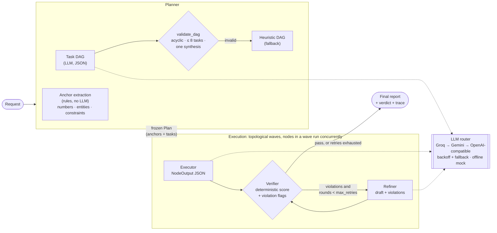

# PEVR: Planner-Executor-Verifier-Refiner Multi-Agent DAG Engine

A small, testable engine for **grounded technical synthesis**. It turns a multi-part request into a DAG of
sub-tasks, runs them with LLM agents, and checks every draft against facts that no model is allowed to
change. Drafts that fail the check are repaired in a closed loop. The engine runs on Groq, Gemini or any
OpenAI-compatible endpoint with automatic fallback, and fully offline with a deterministic mock.

[](https://github.com/charan-reddy-dev/Multi-Agent-LLM-Orchestration/actions/workflows/ci.yml)

```text
$ python -m src.cli "Our checkout service serves 12,000 RPS on PostgreSQL with p99 latency of 840 ms. \
    Identify the likely bottleneck, then propose a Redis caching plan based on that. \
    Keep the answer under 120 words and do not mention Memcached." --mock-faults benchmark

Answer: 12,000 RPS, 840 ms, PostgreSQL, p99, Redis.

[fidelity 1.00 | anchors 5/5 | constraints 2/2 | PASS | 6 LLM calls via mock:deterministic-faulty-v1]
```

(The answer text is the offline mock's. With a live provider it is a real answer, checked the same way.)

## Architecture



| Agent | File | Role |
|---|---|---|
| **Planner** | [`src/agents/planner.py`](src/agents/planner.py) | Extracts **immutable anchors** with rules ([`src/anchors.py`](src/anchors.py)), asks the model for a task DAG, validates it ([`src/dag.py`](src/dag.py)), and falls back to a deterministic clause-based DAG if the model's plan is invalid. A single synthesis task always depends on every analysis task and owns every anchor. |
| **Executor** | [`src/agents/executor.py`](src/agents/executor.py) | Runs each node with its upstream outputs, requiring the `NodeOutput` JSON schema (`title`, `content`, `anchors_used`; extra fields rejected). |
| **Verifier** | [`src/agents/verifier.py`](src/agents/verifier.py) | Pure code, no model. Scores each draft from 0.0 to 1.0 and lists violations: `missing_anchor`, `unsupported_number`, `constraint_violation`, `schema_violation`. |
| **Refiner** | [`src/agents/refiner.py`](src/agents/refiner.py) | Called **only** when the Verifier flags a draft. It receives the draft plus the exact violations, and is re-verified. It runs at most `max_retries` times (default 2). A schema-broken refinement never replaces a valid earlier draft. |

### Immutable anchors

Anchors are extracted by rules, not by a model, so no agent can invent, drop or rewrite one. The
dataclasses are frozen.

| Kind | Examples | Checked by |
|---|---|---|
| number | `36%`, `2.5 s`, `$4.2M`, `10,000 RPS`, `Q3 2025` | must appear verbatim |
| entity | `General Motors`, `PostgreSQL`, `p99`, quoted terms | must appear verbatim |
| constraint | `under 120 words`, `exactly 3 bullet points`, `do not mention Kafka` | rule check on the final answer |

### Verifier score

```text
score = 0.6 * anchor_recall + 0.2 * schema_ok + 0.2 * constraint_pass_rate
        - 0.1 * unsupported_numbers   (penalty capped at 0.3), clamped to [0, 1]
```

A draft **passes** only if it has no violations at all. A draft that can't be parsed scores 0 and
counts every required anchor as missing.

## Quick start

```bash
python -m venv .venv && source .venv/bin/activate      # Windows: .venv\Scripts\activate
pip install -r requirements.txt

python -m src.cli "Compare Redis Streams and Apache Kafka for 10,000 RPS in under 120 words."   # offline mock
python -m src.cli --json "..."                       # full trace: plan, anchors, every verdict
pytest -q                                            # 38 tests, no network or API keys needed
```

## Providers

[`src/providers/router.py`](src/providers/router.py) tries providers in order:

- **Retryable failures** (HTTP 408/409/425/429/5xx, timeouts, transport errors) are retried with
  full-jitter exponential backoff.
- **Non-retryable failures** (bad key, bad request, a Gemini safety block) skip straight to the next
  provider.

Every attempt is logged in `router.calls`.

| Variable | Default | Meaning |
|---|---|---|
| `PEVR_PROVIDERS` | every provider with a key, in the order groq, gemini, openai; `mock` if none | Comma-separated fallback order |
| `GROQ_API_KEY` / `GROQ_MODEL` | `llama-3.3-70b-versatile` | Groq (OpenAI-compatible API) |
| `GEMINI_API_KEY` / `GEMINI_MODEL` | `gemini-2.5-flash` | Google Gemini `generateContent`, JSON mode |
| `OPENAI_API_KEY` / `OPENAI_MODEL` | `gpt-4o-mini` | OpenAI or any compatible server |
| `OPENAI_BASE_URL` | `https://api.openai.com/v1` | e.g. vLLM, Ollama, LM Studio |
| `PEVR_MAX_ATTEMPTS` | `3` | Attempts per provider |
| `PEVR_BACKOFF_BASE_S` | `0.5` | First backoff delay in seconds (doubles each retry, capped at 8 s) |

```bash
export GROQ_API_KEY=... GEMINI_API_KEY=...
python -m src.cli --provider groq,gemini "..."
```

The **mock provider** ([`src/providers/mock.py`](src/providers/mock.py)) reads the JSON each agent
sends and answers like a cooperative model. With a fault profile it injects the failures the Verifier
is meant to catch:

- invalid (cyclic) plans;
- dropped anchors;
- altered numbers;
- broken JSON;
- violated constraints;
- incomplete repairs.

Every choice is seeded, so runs are exactly reproducible.

## Evaluation

[`benchmarks/eval_pevr.py`](benchmarks/eval_pevr.py) runs the 20 cases in
[`benchmarks/cases.json`](benchmarks/cases.json) through the full pipeline:

- 6 `multi_step`: dependent sub-tasks;
- 6 `anchor_preservation`: dense figures and names;
- 8 `constraint_following`: word limits, bullet counts, forbidden terms.

```bash
python benchmarks/eval_pevr.py                       # writes benchmarks/results.json
```

> **What these numbers are, and what they aren't.** The recorded run uses the offline mock, because no
> LLM API key was available. It measures the **pipeline**, not the quality of any language model:
>
> - whether anchors are extracted;
> - whether the plans are valid DAGs;
> - whether the Verifier catches the faults the mock injects;
> - whether the Refiner loop repairs them.
>
> Fault rates were fixed before the first recorded run: `invalid_plan` 0.10, `drop_anchor` 0.25,
> `alter_number` 0.15, `schema_break` 0.10, `constraint_break` 0.20, refiner `fix` 0.80,
> `regression` 0.05, seed 7.
>
> To measure a real model, run
> `python benchmarks/eval_pevr.py --provider groq,gemini --output benchmarks/results-live.json`.

### Verified results

All values come from [`benchmarks/results.json`](benchmarks/results.json):

- commit `e401a26`, seed 7;
- Python 3.14.7, Windows 11;
- command `python benchmarks/eval_pevr.py`.

| Metric (20 cases) | Fault profile `none` | Fault profile `benchmark` |
|---|---|---|
| Expected-anchor extraction recall | 1.0 (90/90) | 1.0 (90/90) |
| Valid DAG rate / planner fallback rate | 1.0 / 0.0 | 1.0 / 0.1 |
| Multi-step cases planned with dependent sub-tasks | 1.0 | 1.0 |
| Final-answer anchor retention: first draft → after refinement | 1.0 → 1.0 | 0.7802 → **0.989** |
| Final-answer constraint satisfaction: first → final | 1.0 → 1.0 | 0.7 → **1.0** |
| Mean fidelity score: first → final | 1.0 → 1.0 | 0.7897 → **0.994** |
| Verified pass rate: first → final | 1.0 → 1.0 | 0.55 → **0.95** |
| Schema compliance, all 48 nodes: first → final | 1.0 → 1.0 | 0.9167 → 0.9792 |
| Injected first-draft faults flagged by the Verifier | n/a | **20/20** (detection rate 1.0), 0 false flags |
| Retry convergence (flagged nodes that end passing) | n/a (0 flagged) | **0.9** (18/20), mean 1.222 rounds |
| LLM calls per case (mean) | 3.4 | 4.7 |
| Pipeline latency per case, mean / p50 / p95 (ms) | 0.99 / 0.891 / 1.174 | 1.114 / 1.06 / 1.701 |

Reading the `benchmark` column:

- **Detection.** The Verifier flagged every first draft that really had an injected fault, and nothing else.
- **Convergence.** 18 of the 20 flagged nodes were repaired within `max_retries=2`. The one final answer
  that still fails (`ap-06`) is missing the anchor `2.1M` after both repair rounds. It is reported as
  failed rather than hidden.
- **Latency.** This is orchestration overhead only, since the mock does no network I/O. Live latency
  is dominated by the provider.

## Limitations

- **No live-model results yet.** The table above measures detection and repair against injected
  faults. A run with real providers is a single command (above) but needs API keys.
- **The unsupported-number check is strict.** Any figure that isn't in the request, apart from 0–10,
  is flagged. This includes correctly derived numbers such as a computed total, so a live model doing
  arithmetic will be penalised.
- **Extraction is heuristic.** Entities are found from capitalisation, acronyms, camelCase and quotes.
  The expected anchors in `cases.json` were labelled by the extractor's author, so 1.0 recall shows
  internal consistency, not generalisation.
- **Verbatim matching.** "2.5 seconds" doesn't satisfy the anchor "2.5 s". This is intentional for
  fidelity, but a live model must be told to copy anchors exactly, which the prompts do.

## Layout

```text
src/
  agents/      planner.py · executor.py · verifier.py · refiner.py
  providers/   router.py · adapters.py (Gemini, OpenAI-compatible) · mock.py · base.py
  anchors.py   dag.py   engine.py   prompts.py   schemas.py   cli.py
benchmarks/    cases.json · eval_pevr.py · results.json
tests/         38 tests: anchors, DAG, verifier, router + HTTP adapters, engine, CLI, eval smoke
legacy/        original prototype upload (not importable, kept for history)
```
